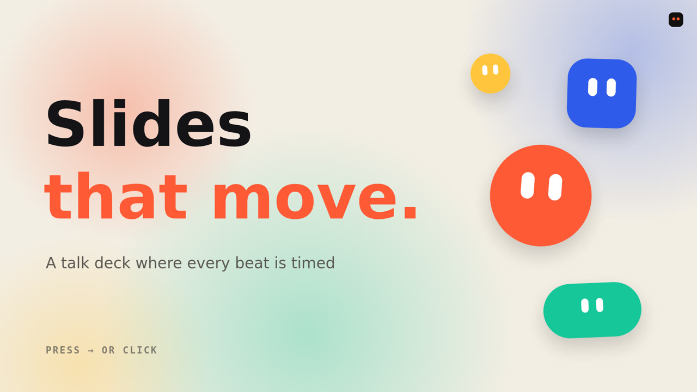
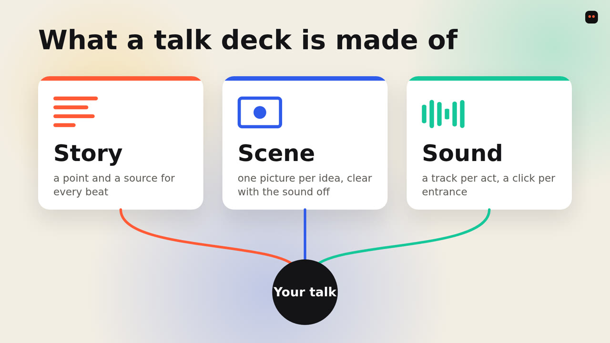

# Animating Slides

A coding-agent skill for **talk decks that move**: full-screen animated HTML slides for a keynote, a meetup or a conference talk. Every beat is timed to a tempo, every page stays alive while you speak, music changes with each act, and the whole deck runs offline from one folder.

It grew out of preparing a real 20-minute meetup talk ([the deck](https://zenowangzy.github.io/grokbot-talk/)). Rounds of feedback found slides that were hard to read with the sound off, a cover that opened black, background music that droned like a motor, and text hidden behind pictures. The talk was also going to run on a venue PC nobody had seen, so it needed an offline package. Each of those lessons is now a rule in the skill or a check in its tools.

[中文说明](#中文说明)




## How it differs from a slide generator

| | Typical HTML slides | Animating Slides |
|---|---|---|
| Starts from | the content | a storyline: every beat has the words, the one point and a source |
| A slide is | a page | a scene: one metaphor played over several steps |
| Animation | CSS transitions on load | a pure function of (step, beats), frozen at any frame for screenshots |
| While you talk | still | idle motion, pointer parallax, hover and pokeable characters |
| Sound | none | a recorded track per act, crossfaded; synthesized sound effects on entrances |
| Checked by | eye | `qa.mjs`: an overlap audit on every step, a key-press tour both ways, console errors |
| Ships as | a link | an offline zip that opens by double-click on the venue PC |

## Install

### Claude Code plugin

```text
/plugin marketplace add https://github.com/ZenoWangzy/animating-slides
/plugin install animating-slides@animating-slides
```

Then ask for a talk deck, or type `/animating-slides:animating-slides`.

### Copy the skill

```bash
git clone https://github.com/ZenoWangzy/animating-slides.git
cp -r animating-slides/skills/animating-slides ~/.claude/skills/
```

### Other coding agents

Point the agent at `skills/animating-slides/SKILL.md`. Everything it needs is in that folder.

## Try the example

```bash
open skills/animating-slides/template/index.html      # or double-click it
node skills/animating-slides/scripts/qa.mjs skills/animating-slides/template --out /tmp/qa
```

Use the arrow keys, space or a click to step. N shows the speaker notes, M mutes, and F goes full screen. Click a character to poke it.

## What's inside

```
skills/animating-slides/
  SKILL.md                 the five phases: storyline, scene plan, build, QA, package
  references/              engine API and gotchas, sound, talk craft
  template/                engine.js + an example deck (4 scenes) + storyline.md
  scripts/
    check-storyline.py     every beat has Say, Point and a real Source
    qa.mjs                 overlap audit + screenshots of every step + key-press tour
    offline.sh             one index.html with scripts and fonts inlined, zipped with media/
    subset-font.py         embed a font, cut to the characters the deck uses
```

Requirements: Chrome or Edge to present; Node 22+ and Chrome for `qa.mjs`; Python 3 for the checkers (`fonttools` and `brotli` for `subset-font.py`).

## Credits

- The skill packaging follows [frontend-slides](https://github.com/zarazhangrui/frontend-slides).
- The talk-craft notes draw on Chris Anderson, Nancy Duarte, and Chip and Dan Heath. Each is cited where it is used.

## License

[PolyForm Noncommercial 1.0.0](LICENSE): free for personal and noncommercial use, including talks you give yourself. Commercial use, such as selling decks made with it or building it into a paid product, needs a separate license. Contact [ZenoWangzy](https://github.com/ZenoWangzy) on GitHub.

## 中文说明

Animating Slides 是一个给编码 agent 用的 skill，用来做**会动的演讲 slides**：全屏 HTML 动画，适合 meetup、发布会和大会分享。每一拍都卡在节奏上；讲者说话时画面不停在动；每一幕换一首配乐；整套 deck 是一个文件夹，离线就能放。

它来自一场真实的 20 分钟 meetup 分享的准备过程（[那份 deck](https://zenowangzy.github.io/grokbot-talk/)）。几轮反馈里发现的问题，现在都成了规则或检查：关掉声音就看不懂的页面、打开是黑屏的封面、像马达一样嗡嗡响的配乐、被图片挡住的字。现场电脑的配置事先不知道，所以还要做离线包。

许可证：PolyForm Noncommercial 1.0.0。个人和非商业用途免费，包括自己上台演讲；商用（比如卖用它做的 deck，或者集成进收费产品）需要另外授权，请在 GitHub 上联系 ZenoWangzy。

用法：装好之后让 agent 做一份演讲 slides。它按五个阶段走：故事线（每一拍写清讲稿、要点和出处）→ 场景方案（每个场景一个比喻加一张静帧，讲者点头再动手）→ 制作 → 检查（`qa.mjs`）→ 离线打包。
